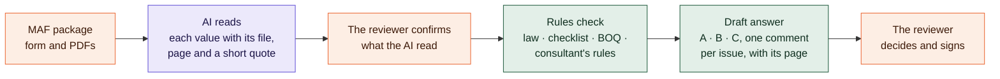
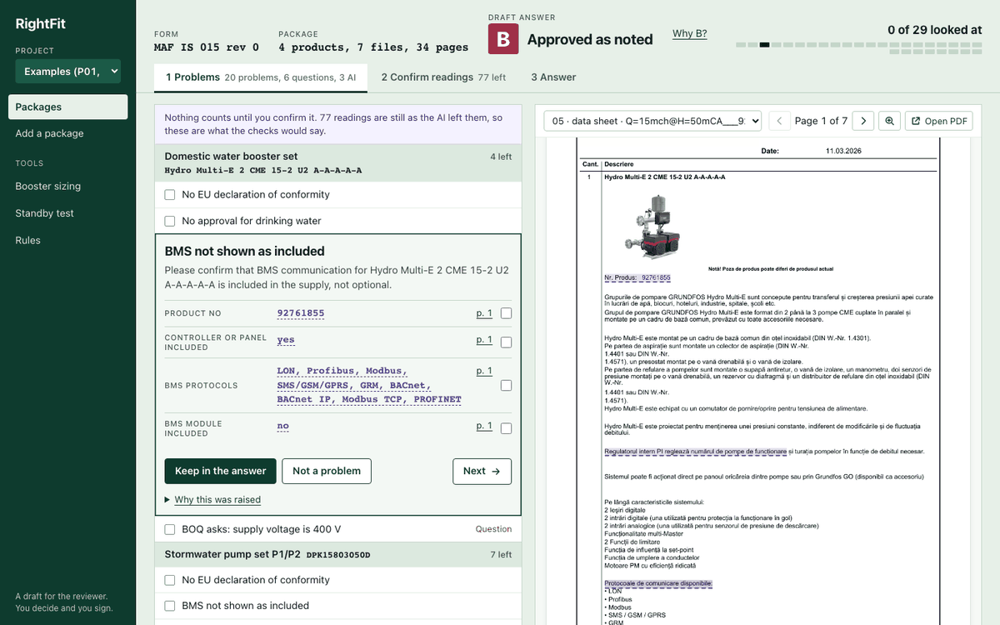
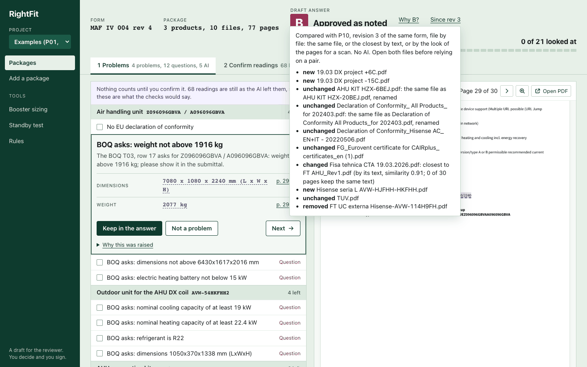
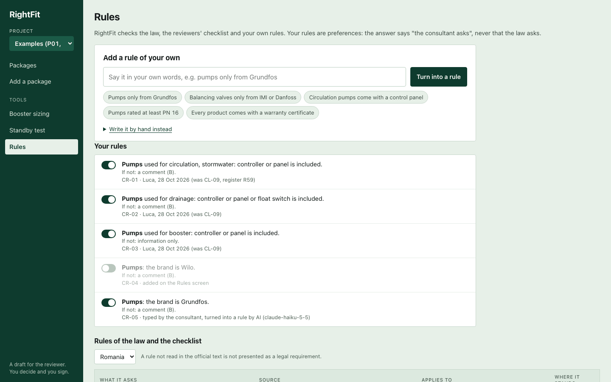
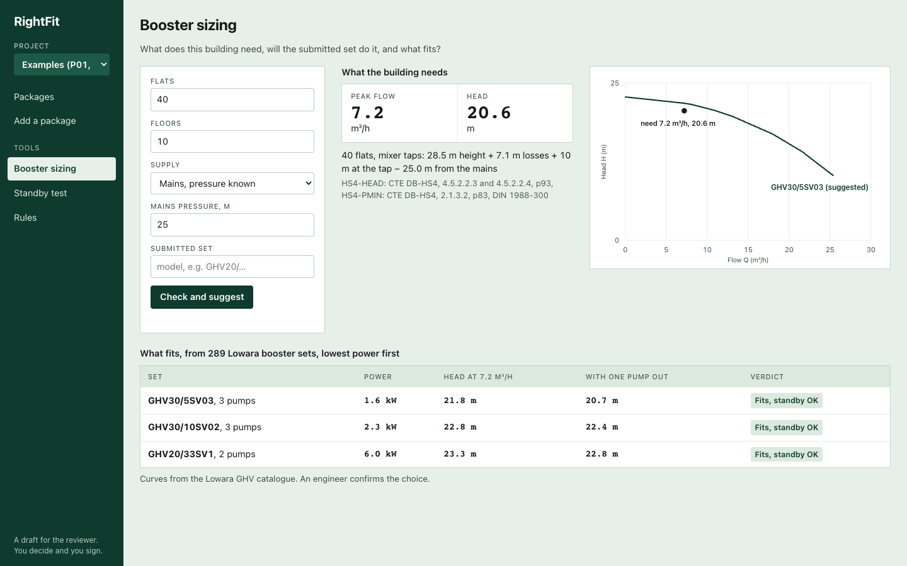
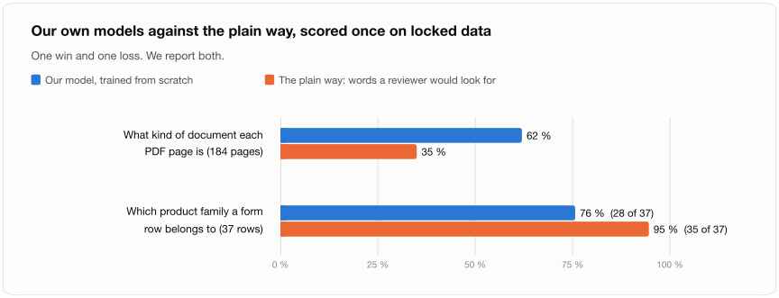
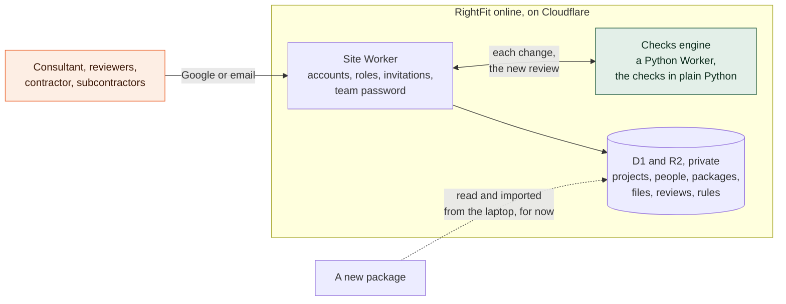
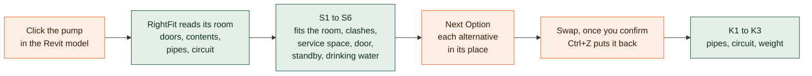
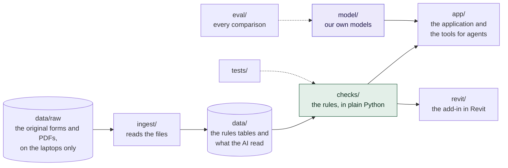

<h1 align="center">RightFit</h1>

<p align="center">
Checks a material approval form for MEP equipment before the consultant signs it<br>
Sahil Khan, Jeff El Khoury, Luca Obejdeanu<br>
IAAC MaAI01 · Operable Futures · 2026–27
</p>

<p align="center">
<a href="checks/"></a>
<a href="model/"></a>
<a href="model/README.md"></a>
<a href="#for-agents"></a>
<a href="web/"></a>
<a href="web/"></a>
<a href="revit/"></a>
</p>

RightFit checks a material approval form (MAF) for MEP equipment before the consultant signs it. It reads the documents attached to the form and checks them against the law in force, the project's bill of quantities (BOQ), a checklist built from past reviewers' comments and the consultant's own rules. Then it drafts the answer, with the page behind every finding. The reviewer decides and signs.

**[Open RightFit online](https://rightfit.hackathon-team6-cubicasa-app.workers.dev)** · [run it on the laptop](#running-it) · [the tools for agents](#for-agents) · [the fit check in Revit](#the-fit-check-in-revit)


<p align="center"><b>AI reads, rules decide, a person signs.</b></p>

## The problem

On the last project Luca worked on, 80 MEP approval forms went through review. 22 came back with notes or for resubmission, and 17 needed at least one revision (one of them needed six). A form usually came back after about 12 days. After the last reviewer had answered, it still sat for a median of 7 days before anyone sent it back to the contractor.

8 of those 22 returns were plain gaps in the package: a data sheet for a whole range with nothing marked, a technical approval past its date, pump panels without the BMS module. Someone has to find these by reading every PDF, and they are exactly the kind of thing a computer can point at.

## What it does

A project holds its MAF packages and its BOQ. For each package RightFit:

- reads the form (.xls) and every attachment, and keeps each value with its file, page, a short quote and a status. A value stays `extracted` until a person confirms it;
- checks the documents: the ones the law asks for, whether a declaration names the product, whether a certificate is still valid on the review date and at delivery, the approval for contact with drinking water where a pump needs one, and whether each attachment is what the form says it is;
- checks the values: the duty point, the pressure rating, the liquid temperature and the ecodesign limits of air handling units;
- checks the reviewers' checklist, the consultant's own rules and what the product's BOQ line asks for;
- follows the law in force on the review date. In Romania that is Law 10/1995 until 24 Aug 2026 and the construction Code (Law 169/2026) from 25 Aug 2026;
- on a resubmission, shows what changed since the previous revision of the form: the same files (renamed or not), the files that changed, and the new and removed ones;
- drafts the answer, A (approved), B (approved as noted) or C (revise and resubmit), with one comment per issue.

A check passes only on confirmed values. Until then it shows what the result would be.



## The review in three steps


The reviewer works in three steps. First the problems, each one beside its page with the quoted line marked. Then confirming what the AI read: violet with a dashed line is what the AI read, black with a solid line is what a person confirmed. Last, the answer, ready to copy. The same three steps open online, on every package RightFit has read.



The same application keeps a project's rules and shows what changed between revisions. The pump tools from the midterm, booster sizing and the standby test, are screens of it too.

| What changed since the last revision | The consultant's own rules | Booster sizing |
|---|---|---|
|  |  |  |

## Where AI is used

The checks are plain Python with no AI in them, so the same package always gives the same result and every result names its rule. AI does the reading, and each AI part is measured against the plain way of doing the same job.

| Job | Done by | Compared with | Result so far |
|---|---|---|---|
| What kind of document each PDF page is | Our own classifier, trained from scratch | Keyword search | 62 % of pages right against 35 %, on 184 locked pages of real packages |
| Which product family a form's row belongs to | Our second classifier, trained from scratch on 21 rows | The family's words (keyword rule) | 28 of 37 locked rows right, against 35 for the words: the words win until there are more labelled rows |
| Which products each document covers | AI matching | Text matching | The same answer on all 51 pairs; the AI also says how a document covers a product |
| Reading values from the documents | AI reader | A person | Not measured yet: 1 of 116 values confirmed so far |
| Turning a rule typed in words, or a BOQ line, into items to check | AI, labelled as AI output | | Not measured; the reviewer sees each item before it counts |
| The whole review | RightFit | General AI chatbots | The protocol was written before any run (`eval/chatbot_baseline/`); no run yet |

<picture>
  <source media="(prefers-color-scheme: dark)" srcset="docs/images/models-dark.svg">
  
</picture>

More in [`spec/constitution/mission.md`](spec/constitution/mission.md) §8 and in [`eval/`](eval/). The trained models are not in Git: the page classifier keeps the words it learned from real documents, and a few of them are names. They are in a private repository on Hugging Face, `lucaobejdeanu/rightfit-models`, with a card that explains them.

The two models taught us two things. The first page classifier learned only from public manufacturer PDFs and found 15 % of the data sheet pages of real packages; trained on real packages as well, the second finds 69 %, so a model has to learn from pages like the ones it will read. And words written by someone who knows the trade can beat a model that had too few examples: with 21 training rows for 13 families, the family model got 28 of 37 locked rows right, the family's words 35.

## RightFit online

RightFit online is where the team works, at https://rightfit.hackathon-team6-cubicasa-app.workers.dev since 20 Nov 2026 (`web/`, spec `spec/features/rightfit_online.md`). The consultant opens a project and invites the other reviewers, the client and the contractor, and the contractor invites its subcontractors. Each person signs in with Google or with an email and sees what their role lets them see; a subcontractor never sees another subcontractor's part. The team that runs it has a Management page and an activity log, and Management never opens a project's packages, files or BOQ.


Since 21 Nov the project's own data is online too: the 51 packages with their original files, RightFit's review of the packages already read, the rules the checks used, and the BOQ lines, never the prices. It sits in a locked project, which opens only for its members and only with the team password as well, and the files are in a private bucket in Western Europe. A package RightFit has read opens in the laptop's three steps, problems, readings and answer, with every check and what passed, and a Rules tab shows the law's rules, the reviewers' checklist and the consultant's own. Since the evening of 21 Nov the reviewers also work there: they tick what the AI read, keep a finding in the answer or mark it as not a problem with the reason, and decide on the AI's suggestions, while the consultant switches the consultant's rules on or off and writes new ones. Each change runs the checks again, in a Python Worker on Cloudflare that holds the laptop's own review code and answers only the site.


A person gets in in four steps: an account, with Google or with an email and a password; the terms, which open the first time and again when they change; a role in the project, from an invitation for their email or from a project they open; and, for a locked project, the team password as well. The person who invites sends the link in their own email, because RightFit online sends no email.

The terms, privacy policy, data processing agreement, cookie policy and legal notice are in `web/legal/`. They are drafts: the operator's details and a lawyer's review are still missing.

It is built like the AI Methods hackathon app, a Cloudflare Worker with a React page, Better Auth and D1, on Luca's Cloudflare account. On the laptop it runs with `npm run dev` in `web/`, and `npm test` there runs its 20 tests; [`web/README.md`](web/README.md) has the steps.

## How it works



Everything a reviewer does happens online. The site's Worker checks the account, the role and, for a locked project, the team password before it reads D1 or R2. When a reviewer ticks a reading, keeps or dismisses a finding or decides on an AI suggestion, or the consultant changes a rule, the Worker sends the change to the checks engine (`web/engine/`), a Python Worker that only the site can call. The engine runs the same checks as the laptop app (`app/review_core.py`), sends back the new review and keeps nothing; the Worker stores it. One step still starts on the laptop: a new package is read there, and `web/scripts/import_project.py` puts its files, readings and review online, while a later import keeps what was done online. Agents reach the same checks through the MCP server (`app/mcp_server.py`), which only reads, and our two models are kept in the private repository on Hugging Face.

## Parts, and when they came

| Part | Where | Since |
|---|---|---|
| The rules tables, the documents of each family and the reviewers' checklist | [`data/maf/`](data/maf/) | 28 Oct 2026 |
| The review page on the laptop, which grew into the review app | [`app/`](app/) | 29 Oct 2026 |
| Our page classifier, version 1, and its comparison with a keyword search | [`model/`](model/), [`eval/`](eval/) | 29 Oct 2026 |
| The checks as MCP tools for agents | [`app/mcp_server.py`](app/mcp_server.py) | 11 Nov 2026 |
| The page classifier, version 2, trained on real packages as well | [`model/`](model/) | 11 Nov 2026 |
| The rule watch, what changed since the last revision, and the family classifier | [`ingest/`](ingest/), [`app/`](app/), [`model/`](model/) | 17 Nov 2026 |
| The fit check in Revit | [`revit/`](revit/), [`checks/space/`](checks/space/) | 17 Nov 2026 |
| RightFit online: accounts, roles, invitations, Management and the legal documents | https://rightfit.hackathon-team6-cubicasa-app.workers.dev | 20 Nov 2026 |
| The project's data online, with the review of each read package and the rules | the same site, in a locked project | 21 Nov 2026 |
| The checks engine online, and the review done online by the reviewers | the same site, [`web/engine/`](web/engine/) | 21 Nov 2026 |
| Our two models on Hugging Face | a private repository | 21 Nov 2026 |

## The fit check in Revit

Jeff's part, merged on 17 Nov 2026: `revit/` and `checks/space/`, with its spec in `spec/features/revit_fit_check.md`. The MAF review checks what a product is; the fit check shows where it goes. It runs inside the project's own Revit model through pyRevit, a free add-in that runs Python in Revit, on the Windows computer that has Revit.

The architect clicks the pump set in the model. RightFit finds the room it stands in, also in a linked model, and reads the room's outline and height, its doors, everything else standing in it, the pipes that end at the pump and the pump's circuit. It checks the set where it stands and lists how each alternative from the data sheets would do in the same place:

| Check | Question | Rule and its status |
|---|---|---|
| S1 | Does the set stand inside the room and under its ceiling? | I9-2022 art. 19.2, to confirm |
| S2 | Does it hit anything drawn in the model, the door swings included? | I9-2022 art. 19.2, to confirm |
| S3 | Is the service space around it free? | the consultant's own figures for the project; there is no legal one |
| S4 | Does it go through a door of the room, standing, on its narrow side? | I9-2022 art. 17.11, to confirm |
| S5 | Can one pump alone carry the duty, as the standby test found? | I9-2022 art. 6.56, confirmed by Luca |
| S6 | Is there an approval for contact with drinking water? | Order MS 275/2012, read on the official text |



Next Option shows each alternative in the pump's place as a preview: the maker's Revit family or 3D DWG when the project has it, otherwise a stand-in drawn from the catalogue sizes. A family is drawn from a shape saved once by Prepare Models, because loading the makers' families froze Revit; `revit/README.md` says how. Swap puts the chosen alternative into the model once the architect confirms it. It keeps the mark and comments, writes RightFit's verdict into the element and shows what the swap changes: pipe ends that no longer meet the set (K1), more motor power on the circuit, which goes back to the electrical engineer (K2), and the change in weight, which goes to the structural engineer (K3). Ctrl+Z undoes the whole swap.

The checks are the same plain Python file the tests run, with no AI and no network. A value read from the model counts as the design's own; a value from a data sheet stays `extracted` until a person confirms it, and until then a verdict is what the check would say. Every result names its rule and the rule's status, and the report says that RightFit does not certify. The project's own data (the alternatives, the service space, the makers' files) stays in `data/projects/<project>/revit/`, outside Git.

What the review of the code on 17 Nov 2026 found:

- the door check takes the door's width parameter, not the clear opening, so a set within a few centimetres of the width passes and may still not get through;
- the circuit check compares the motors' output power, not the power they draw, so a less efficient set with the same motors adds load without a flag;
- every door is taken to open into the room and every obstacle as a box along the model's axes, so a diagonal pipe or a turned set can show a clash that is not there; these are false alarms, never missed clashes;
- a set whose data sheet leaves a size empty stops the check with an error, and Test Room deletes any room named like the test room, so it must not be pressed in the project's model; both are to fix before it is used on the project's model.

It has been tried in Revit 2026 on a test room, not yet on the project's model, and its rules wait for Luca.

## Where we are (21 Nov 2026)

- Two packages are read: P01, a set of Grundfos pumps, and P02, an air handling unit with its outdoor units, already at revision 4. Of what the AI read, 1 of 116 values and 2 of 15 documents are confirmed so far, so most results are still what a check would say.
- 48 more packages from the same project are on our laptops, and since 21 Nov in RightFit online as well. The app lists them; none is read yet.
- All 28 legal rules in `data/maf/rules.csv` have been read in the official text, the last nine on 16 Nov. The other four are reviewers' practice and one engineer's input, and each rule shows which it is.
- On 17 Nov the rule watch started asking the official sources whether the act behind a rule changed (all 28 unchanged on its first run), the reviewer's decisions moved into the project folder, a resubmission began to show what changed since the previous revision, and our second own model started naming a product's family from its form row, though the family words still beat it (35 against 28 of 37 rows). Jeff's fit check in Revit was merged the same day; see above.
- RightFit online has been live since 20 Nov, with Google sign-in. Since 21 Nov it holds the project's own data in a locked project, and the reviewers do the review there: each change runs the checks again online, in a Python Worker; see above.
- 164 tests for the Python part (`pytest`) and 20 for RightFit online (`npm test` in `web/`) pass.
- Since 21 Nov our two scored models are in a private repository on Hugging Face, with a card for the whole project.
- All the packages come from one project, so for now the results are a demonstration, not an evaluation.

The project started as a kitchen hood selector. On 5 Nov 2026 the team moved it to MAF review, and the hood version stays in the Git history.

## Running it

Tested with Python 3.14 on macOS.

```
pip install -r requirements.txt
brew install tesseract           # OCR for scanned pages when a pump package is added (macOS)
pytest
python app/review_server.py      # the application: http://127.0.0.1:8520
python app/mcp_server.py         # the checks as MCP tools; an agent starts it from .mcp.json
python -m ingest.rule_watch      # has the act behind each legal rule changed since it was read?
```

The app works on one project at a time, picked in the left rail. Each project is a folder in `data/projects/` (not in Git): its packages, their original files and its BOQs. To share projects, point the app at a shared folder, for example on Google Drive: `python app/review_server.py --projects "<the shared folder>"`. With no project, the app shows P01 and P02 from `data/maf/extracted/`, which is in Git; their original PDFs and forms stay on our laptops in `data/raw/`. Each person starts it with their own name, `python app/review_server.py --reviewer "Jeff"`, which is kept next to every confirmation and decision (Luca when no name is given). The app answers only its own page, so another site open in the same browser can neither read the packages nor confirm or decide anything.

The AI parts (a rule typed in words, what a BOQ line asks) use the Claude command line (`claude`) installed and signed in on the laptop.

## For agents

`app/mcp_server.py` gives any agent that speaks MCP six read-only tools: list the packages, review one, list the rules with their status, classify a package's pages, compare a package with the previous revision of its form, and ask the official sources whether the act behind each legal rule changed since it was read. No tool can confirm a reading or approve a package; that stays with the reviewer. The project's `.mcp.json` tells the agent how to start it, and `.codex/config.toml` does the same for a second agent client.

## How the repository is organised

The code follows the way a package travels: the files are read, the rules check them, and the application shows the result. Each folder has a short README of its own.



| Folder | What is in it |
|---|---|
| [`app/`](app/) | the application the reviewer opens in the browser, and the same checks as tools for AI agents |
| [`web/`](web/) | RightFit online: the project space where the consultant, the contractor and the subcontractors meet, with Google sign-in, roles, invitations, the project's review and rules, edited by the reviewers, Management and the legal documents |
| [`checks/`](checks/) | every check, in plain Python with no AI |
| [`ingest/`](ingest/) | reading the forms, the BOQs, the official sources of the rules and the revisions |
| [`data/`](data/) | the rules tables, and what the AI read from P01 and P02 |
| [`model/`](model/) | our own models |
| [`eval/`](eval/) | every comparison with the plain way |
| [`tests/`](tests/) | the tests: run `pytest` |
| [`revit/`](revit/) | Jeff's fit check in Revit |
| [`spec/`](spec/) | the plan: mission, roadmap, tools and each feature |
| [`docs/`](docs/) | decisions, the data map, the rules, the other notes and the images of this README; `docs/images/make_diagrams.py` draws the three steps, the chain of invitations and the way in |

The files in the root:

| File | What it is for |
|---|---|
| [`AGENTS.md`](AGENTS.md) | how anyone, a person or an agent, works in this repository |
| `CLAUDE.md` | one line that points Claude Code to `AGENTS.md` |
| `.mcp.json` | tells an agent how to start the MCP server, `app/mcp_server.py` |
| `.codex/config.toml` | the same, for Codex, a second agent client |
| [`DESIGN.md`](DESIGN.md), [`PRODUCT.md`](PRODUCT.md) | the look of the application, and who it is for |
| `requirements.txt`, `pytest.ini` | the Python packages to install, and where the tests are |
| `.gitignore` | what never goes into Git: the originals, the projects, the BOQs and local tool files |

## A few rules

The repository is public, so nothing confidential goes into Git: no client, project, company or personal names, no prices, no original PDFs and no models trained on them. Manufacturer names and model codes are fine. Every technical value needs a source, and when we can't find one the value stays `unclear`. Decisions go in `docs/decisions.md` so they don't get lost in chat.
