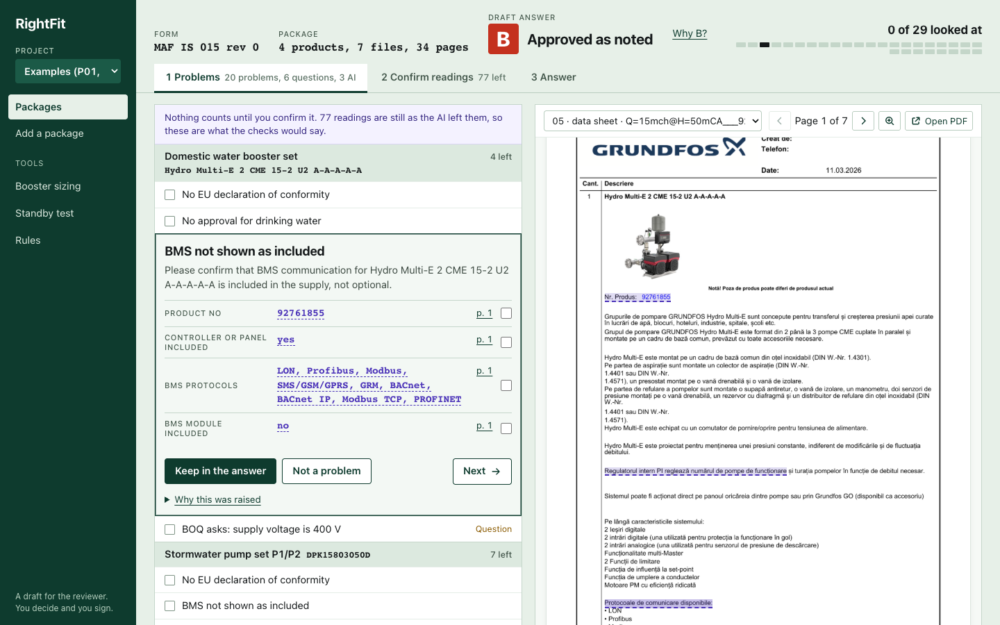

# RightFit

RightFit checks a material approval form (MAF) for MEP equipment before the consultant signs it. It reads the documents attached to the form and checks them against the law in force, the project's bill of quantities (BOQ), a checklist built from past reviewers' comments and the consultant's own rules. Then it drafts the answer, with the page behind every finding. The reviewer decides and signs.

AI reads, rules decide, a person signs.

IAAC MaAI01 · Operable Futures · 2026–27 · Sahil Khan, Jeff El Khoury, Luca Obejdeanu



## The problem

On the last project Luca worked on, 80 MEP approval forms went through review. 22 came back with notes or for resubmission, and 17 needed at least one revision (one of them needed six). A form usually came back after about 12 days. After the last reviewer had answered, it still sat for a median of 7 days before anyone sent it back to the contractor.

8 of those 22 returns were plain gaps in the package: a data sheet for a whole range with nothing marked, a technical approval past its date, pump panels without the BMS module. Someone has to find these by reading every PDF, and they are exactly the kind of thing a computer can point at.

## What it does

A project holds its MAF packages and its BOQ. For each package RightFit:

- reads the form (.xls) and every attachment, and keeps each value with its file, page, a short quote and a status. A value stays `extracted` until a person confirms it;
- checks the documents: the ones the law asks for, whether a declaration names the product, whether a certificate is still valid on the review date and at delivery, the approval for contact with drinking water where a pump needs one, and whether each attachment is what the form says it is;
- checks the values: the duty point, the pressure rating, the liquid temperature and the ecodesign limits of air handling units;
- checks the reviewers' checklist, the consultant's own rules and what the product's BOQ line asks for;
- follows the law in force on the review date. In Romania that is Law 10/1995 until 24 Aug 2026 and the construction Code (Law 169/2026) from 25 Aug 2026;
- on a resubmission, shows what changed since the previous revision of the form: the same files (renamed or not), the files that changed, and the new and removed ones;
- drafts the answer, A (approved), B (approved as noted) or C (revise and resubmit), with one comment per issue.

A check passes only on confirmed values. Until then it shows what the result would be.

The reviewer works in three steps. First the problems, each one beside its page with the quoted line marked. Then confirming what the AI read. Last, the answer, ready to copy. The pump tools from the midterm, booster sizing and the standby test, are screens of the same application.

## Where AI is used

The checks are plain Python with no AI in them, so the same package always gives the same result and every result names its rule. AI does the reading, and each AI part is measured against the plain way of doing the same job.

| Job | Done by | Compared with | Result so far |
|---|---|---|---|
| What kind of document each PDF page is | Our own classifier, trained from scratch | Keyword search | 62 % of pages right against 35 %, on 184 locked pages of real packages |
| Which products each document covers | AI matching | Text matching | The same answer on all 51 pairs; the AI also says how a document covers a product |
| Reading values from the documents | AI reader | A person | Not measured yet: 1 of 116 values confirmed so far |
| Turning a rule typed in words, or a BOQ line, into items to check | AI, labelled as AI output | | Not measured; the reviewer sees each item before it counts |
| The whole review | RightFit | General AI chatbots | The protocol was written before any run (`eval/chatbot_baseline/`); no run yet |

More in [`spec/constitution/mission.md`](spec/constitution/mission.md) §8 and in [`eval/`](eval/).

## Running it

Tested with Python 3.14 on macOS.

```
pip install -r requirements.txt
brew install tesseract           # OCR for scanned pages when a pump package is added (macOS)
pytest
python app/review_server.py      # the application: http://127.0.0.1:8520
python app/mcp_server.py         # the checks as MCP tools; an agent starts it from .mcp.json
python -m ingest.rule_watch      # has the act behind each legal rule changed since it was read?
```

The app works on one project at a time, picked in the left rail. Each project is a folder in `data/projects/` (not in Git): its packages, their original files and its BOQs. To share projects, point the app at a shared folder, for example on Google Drive: `python app/review_server.py --projects "<the shared folder>"`. With no project, the app shows P01 and P02 from `data/maf/extracted/`, which is in Git; their original PDFs and forms stay on our laptops in `data/raw/`.

The AI parts (a rule typed in words, what a BOQ line asks) use the Claude command line (`claude`) installed and signed in on the laptop.

## For agents

`app/mcp_server.py` gives any agent that speaks MCP six read-only tools: list the packages, review one, list the rules with their status, classify a package's pages, compare a package with the previous revision of its form, and ask the official sources whether the act behind each legal rule changed since it was read. No tool can confirm a reading or approve a package; that stays with the reviewer. The project's `.mcp.json` tells the agent how to start it, and `.codex/config.toml` does the same for a second agent client.

## Where we are (16 Nov 2026)

- Two packages are read: P01, a set of Grundfos pumps, and P02, an air handling unit with its outdoor units, already at revision 4. Of what the AI read, 1 of 116 values and 2 of 15 documents are confirmed so far, so most results are still what a check would say.
- 48 more packages from the same project are on our laptops. The app lists them; none is read yet.
- All 28 legal rules in `data/maf/rules.csv` have been read in the official text, the last nine on 16 Nov. The other four are reviewers' practice and one engineer's input, and each rule shows which it is.
- All the packages come from one project, so for now the results are a demonstration, not an evaluation.

The project started as a kitchen hood selector. On 5 Nov 2026 the team moved it to MAF review, and the hood version stays in the Git history.

## Where things are

| To see | Open |
|---|---|
| the application | [`app/`](app/): the server `review_server.py` and the screens in `review/` |
| the checks and the draft answer | [`checks/maf/`](checks/maf/) |
| reading the forms and the BOQs | [`ingest/`](ingest/) |
| our models | [`model/`](model/) |
| every comparison with a baseline | [`eval/`](eval/) |
| the feature in detail | [`spec/features/maf_checker.md`](spec/features/maf_checker.md) |
| the problem, scope and principles | [`spec/constitution/mission.md`](spec/constitution/mission.md) |
| milestones and who does what | [`spec/constitution/roadmap.md`](spec/constitution/roadmap.md) |
| tools and architecture | [`spec/constitution/tech_stack.md`](spec/constitution/tech_stack.md) |
| the rules and where they come from | [`docs/maf_rules.md`](docs/maf_rules.md), [`docs/jurisdictions.md`](docs/jurisdictions.md) |
| the data we have and need | [`docs/data_map.md`](docs/data_map.md) |
| what the old register tells us | [`docs/maf_register_findings.md`](docs/maf_register_findings.md) |
| the look of the application | [`DESIGN.md`](DESIGN.md) |
| how to work in this repository | [`AGENTS.md`](AGENTS.md) |
| decisions so far | [`docs/decisions.md`](docs/decisions.md) |

## A few rules

The repository is public, so nothing confidential goes into Git: no client, project, company or personal names, no prices, no original PDFs. Manufacturer names and model codes are fine. Every technical value needs a source, and when we can't find one the value stays `unclear`. Decisions go in `docs/decisions.md` so they don't get lost in chat.
