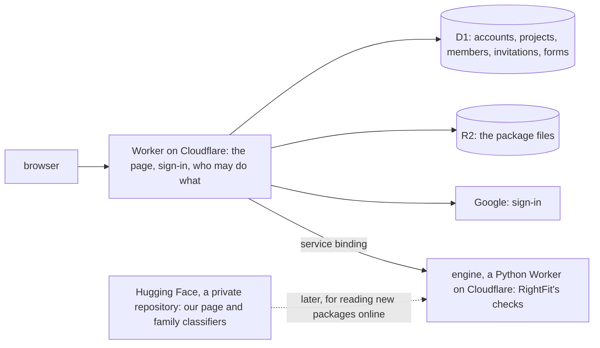

# Feature spec: RightFit online, the project space

20 Nov 2026. Features MAF-31 to MAF-33 in `spec/constitution/roadmap.md`. Built like the app of the AI Methods hackathon (16 to 20 Nov): a page and a Worker on Cloudflare, accounts with Better Auth, D1 for facts, R2 for files, and the Python part on Render.

## 1. What it does

RightFit online is where the parties of one project meet around the material approval forms. A consultant opens the project and invites the contractor and the other reviewers. The contractor invites its subcontractors. Everyone signs in with Google or with an email and a password, and sees only what their role in that project lets them see.

Then the forms move through it: a subcontractor prepares a package, the contractor runs RightFit's check before sending it on, the reviewers answer, and everyone sees whose turn it is and since when. The register says why this matters: after the last reviewer had answered, a form still waited a median of 7 days before it got back to the contractor (`mission.md` §1). That time is spent carrying paper, not reading it.

The review app on the laptop (`app/review_server.py`) stays the reviewer's working tool. RightFit online is the shared space around it.

## 2. How it fits the constitution

- Humans decide. The app never answers a form: it shows RightFit's draft, labelled as RightFit's, next to the reviewer's own answer.
- The project's real packages may be stored in the app's private storage (R2), because the project's parties agreed to their use (Luca, 20 Nov 2026). They never go into Git, which is public.
- Every request is checked on the server, in this order: signed in, terms accepted, a member of the project, and the role allows it. Every query names the project and the person.
- Secrets (the session secret, Google's client secret, the key between the Worker and the engine) are Cloudflare or Render secrets, never in the code.
- The checks stay the deterministic Python in `checks/`; the engine on Render runs the same code as the tests.
- The new dependencies are listed in `docs/decisions.md`.

## 3. The parts

| Part | Where | What it keeps |
|---|---|---|
| The page (React) | Cloudflare, static files | nothing secret: anyone can read a page's code |
| The Worker | Cloudflare | the API, sign-in and the rules of who may do what (`web/worker/`) |
| D1 | Cloudflare | accounts, projects, members, invitations, and later the forms and their steps |
| R2 | Cloudflare | the files of the packages (MAF-32) |
| The engine | Cloudflare, a Python Worker with no address of its own (`web/engine/`) | nothing: it runs the laptop's own review code (`app/engine.py`, `app/review_core.py`, `checks/maf/`) on what the Worker sends and answers (MAF-33) |
| Our models | Hugging Face, private | the page classifier and the family classifier, each with its model card; private because they learned from the real packages and their words can carry names from the forms |

## 4. Roles, and who invites whom

A role belongs to a person in one project: the same person can be a contractor in one project and a subcontractor in another.

| Role | In Romanian | Comes in through | May invite |
|---|---|---|---|
| consultant | consultant | creates the project, or another consultant | consultant, designer, site supervisor, client, contractor |
| designer | proiectant | a consultant | designer |
| site supervisor | diriginte de șantier | a consultant | site supervisor |
| client | beneficiar | a consultant | client |
| contractor | antreprenor | a consultant | contractor, subcontractor |
| subcontractor | subcontractor | the contractor | subcontractor |

Everyone may invite a colleague in their own role. The team page draws the chain from who invited whom.

## 5. What each role sees

| Role | People | Forms (MAF-32) |
|---|---|---|
| consultant, designer, site supervisor, client | the whole team | every form sent to the reviewers |
| contractor | the whole team | every form of the project |
| subcontractor | the reviewers, the contractor, the people above it in the chain and its own branch | the forms of its branch |

A branch starts at the first person of a firm in the chain. It holds that person, the colleagues they brought in with the same role, and everyone any of them invited, down the chain. A subcontractor never sees another subcontractor's branch. Pending invitations follow the same rule: reviewers and the contractor see all of them, the others only those sent from their own branch.

## 6. Signing in and invitations

- Sign in with Google, or with an email and a password of at least 10 characters, kept only as a salted slow hash. The terms and the privacy note are accepted once for each version.
- An invitation holds the project, the email, the role, the company, who invited, when, an expiry of 14 days and a secret token. The page shows the link `/join/<token>` to the person who invites, to send in their own email: the app sends no email (§9).
- To accept, a person needs the link and an account with the same email. A pending invitation also appears on the home screen of a Google account with that email, because Google has verified the address.
- The token is kept only as a hash, so the database alone can't be used to join.
- Whoever sent an invitation, or any consultant, may withdraw it while it is pending. A consultant may remove a member; the project keeps at least one consultant.
- "Delete my account" removes the person's sessions, sign-in links, consent and memberships. A project where they are the only consultant asks them to hand it over first.

## 7. Data

Better Auth's tables (`user`, `session`, `account`, `verification`) and:

| Table | Columns |
|---|---|
| `consent` | person, terms version, date |
| `project` | id, name, country (RO or ES), who created it, when, and the data processing agreement the consultant accepted for their organisation (version, by whom, when) |
| `member` | project, person, role, company, who invited them (member id), when they joined |
| `invitation` | id, project, email, role, company, who invited (member id), the token's hash, when, expiry, state (pending, accepted, declined, withdrawn) |

| `event` | the activity log: when, who (a user id, never an email), which project, what happened; kept 12 months |

MAF-32 adds the forms, their files and their steps.

## 8. The interface

- One sign-in screen: Continue with Google first, the email below. A person who came with an invitation sees it on the same screen: who invited them, to which project, as what.
- Home: what waits for this person first (invitations; later, forms to answer or to fix), then their projects, each with their role in it.
- The project: the team as the chain, top to bottom, reviewers, contractor, subcontractors; each person with name, company, role and who invited them; pending invitations drawn dashed. Invite offers only the roles this person may invite.
- English, as everything in the repository. The colours and type of the review app, so both read as RightFit. It works on a phone, at 375 px wide.

## 9. Management (Luca, 20 Nov 2026)

The people who run RightFit see every account and every project, and can put things right: make another member a project's consultant, take someone out, withdraw an invitation, sign someone out everywhere, delete an account or a project (its name typed again). Only the accounts named in the `ADMIN_EMAILS` secret open Management, and only signed in with Google: an address typed next to a password proves nothing, as nobody checked it. Everyone else gets "not found" for it. Every change made there goes in the activity log, with the other steps people take (an account made, the terms accepted, a project opened, an invitation sent or answered, someone joining or taken out).

## 10. The legal documents

Drafted on 20 Nov 2026, as Luca asked, in `web/legal/` and shown in the app: the Terms of Service, the Privacy Policy (GDPR Articles 13 and 14), the Data Processing Agreement (GDPR Article 28, with the processing, the security measures and the sub-processors in three annexes), the Cookie Policy and the Legal Notice (LSSI-CE Article 10). Everyone accepts the terms, having read the privacy policy, at first sign-in; the consultant who opens a project accepts the data processing agreement for their organisation, because the forms and files of a project are its data and RightFit processes them for it. The versions and dates are recorded. The operator's own records are in `docs/legal/`. They are drafts until a lawyer has read them and the operator is named [O].

## 11. The project's own data online (MAF-35, Luca, 20 Nov 2026)

Luca wanted the project's data in the online app as in the review app on the laptop: the MAF packages, their files, the reviews and the BOQ. `web/scripts/import_project.py` takes the project the review app has open and puts it online:

| What | Where it goes | What is left out |
|---|---|---|
| every package: form, revision, discipline, products, files, pages | D1, table `package` | |
| the original files of each package | the private R2 bucket `rightfit-files`, read only through the Worker | |
| RightFit's review of the packages already read: the whole page the laptop shows (every check with its readings, rules and pages, what passed, the AI's suggestions, the readings page by page, the draft answer) and the reviewer's decisions taken on the laptop | R2, one JSON file per package | it is the laptop's draft of that day; it becomes live once the engine runs online (MAF-33) |
| the rules the checks used for the project's country: the law's, the reviewers' checklist, the consultant's own | R2, `rules.json` | |
| the BOQ lines: chapter (the sheet), row, number, text, unit, quantity, producer, standards | D1, table `boq_line` | the prices, and the BOQ file itself, which stay on the laptop |

A package opens in the laptop's three steps (problems, readings, answer), with the document beside them on a wide screen, and the project has a Rules tab. The letter is called RightFit's draft, not an answer.

**Editing online (Luca, 21 Nov 2026).** The reviewers (consultant, designer, site supervisor, client) tick readings, one or a whole page at a time, keep a finding in the answer or mark it as not a problem with the reason, and decide on the AI's suggestions; the consultant alone switches the consultant's rules on or off and writes new ones by hand. The contractor and the subcontractors read the review. Each change goes to the engine, which applies it with the laptop's own code and runs the checks again; the Worker keeps the result:

| What | Where it is kept |
|---|---|
| a package's readings, the BOQ lines found for it and the reviewer's decisions (its state), which change online | R2, `state/<package>.json`, changed only when nobody else changed it in between (two people at once: the later one starts again from the other's change) |
| the review the engine made from them, which the package's page reads | R2, `reviews/<package>.json`, and its letter and counts in D1 for the list |
| the rule tables of `data/maf` with this project's consultant's rules | R2, `tables.json`; a rule change reviews every read package again |
| who changed what, without the values | the activity log in Management |

Each tick and decision keeps the name of the person who made it and the day. An import from the laptop again keeps what is online: a package whose state is online, and the consultant's rules online, stay as they are; `--replace-online-work` writes the laptop's over them.

**One app (Luca, 21 Nov 2026: "trebuie sa fie acelasi lucru").** Everything a reviewer does is online, and the laptop app only adds and reads a new package:

| What | How it is online |
|---|---|
| the pages beside the review, with the quoted lines marked | the import draws every page of a read package's attachments (`--pages`, or with the files) and finds each quoted line on its page, both with the laptop's own code; R2 `pages/` and `extra/<package>.json` |
| what changed since the previous revision of the form | worked out at the import (`ingest/revisions.py`), in `extra/<package>.json` |
| the review and delivery dates | a reviewer sets them per package; the engine runs the checks again with them |
| the downloads (the draft, the confirmed values, what was marked not a problem) | made in the browser from the review |
| booster sizing | a project tab; the engine runs `app/booster.py` with the catalogue bundled in it |

**Adding packages (Luca, 22 Nov 2026: a new project had nowhere to take packages or BOQs).** On the site, the reviewers and the contractor add a package to any project: its form and attachments (PDF, Excel, Word, images, 60 MB each) go into the project's private storage, and the package waits to be read (`worker/upload.ts`, a package row with `uploaded_by`; an import from the laptop leaves it as it is). On the laptop, the Packages and BOQs screen is back, with a button that puts the project online (`web/scripts/import_project.py` with the project's link, or a new project under the consultant's email); it sends only files that are not online yet (a record in the project folder). Reading a new package is not a button anywhere yet: P01 and P02 were read by an AI agent following the reader's instructions (`spec/features/maf_checker.md`, section 3). Making it automatic online needs an AI key and a server that reads PDFs, which waits for Luca.

Still on the laptop: reading a new package (the AI, OCR, the page classifier), the standby test, which reads the curve of a package being added, and the BOQ files with their prices. Writing a rule in one's own words for the AI to turn into one is on the laptop too until RightFit online has its own key for the AI. The laptop app's review screens point to the same package online, with a link to its own copy only for when the site cannot be reached.

The project is **locked**: besides being a member, a person needs the team password, which only the team knows and which is kept as a Cloudflare secret (`TEAM_PASSWORD`). The browser keeps a hash of it for 7 days, never the password. Five wrong tries in 15 minutes make a person wait, and every try goes in the activity log. Until forms have a branch (MAF-32), a subcontractor sees none of the imported packages or the BOQ.

## 12. Phases

| ID | What | Done when |
|---|---|---|
| MAF-31 | Accounts, projects, roles and invitations, with Google | it runs locally and online, and the rules of who may invite whom and who sees what have tests |
| MAF-32 | Forms: a subcontractor prepares a form and its files, the contractor checks and sends it, each reviewer answers; everyone sees whose turn it is and since when | a form goes from a subcontractor to the reviewers and back, online |
| MAF-33 | The engine: the Worker sends a package and a person's change to RightFit's checks and shows the new draft, labelled. Since 21 Nov a Python Worker on Cloudflare with the laptop's own code, not Render; reading a new package online (OCR, the AI, our models) still needs a server, later | the draft online matches the review app's on P01 and P02 (done 21 Nov: `tests/test_engine.py`, and on Cloudflare the same letter and counts) |
| MAF-34 | The BOQ register, after MAF-31 to MAF-33 (Luca, 20 Nov): for each category of the BOQ, which lines an approved form already covers. One form covers a range: a data sheet for 30 diameters of one pipe covers all 30 lines, so they need no form each | its own spec, written when MAF-33 is done |

## 13. Tests

The rules of who may invite whom, who sees what and who opens Management are one small module, `web/worker/roles.ts`, with tests that run with Node's own test runner (`npm test`). The routes are tried locally with five accounts, the way people would use them: a person who is not a member gets "not found" for the project, a subcontractor can't invite a contractor nor see another subcontractor, an invitation can't be accepted from an account with another email nor twice, only a consultant takes people out, and deleting an account withdraws its pending invitations. Management was tried the same way: an admin address typed with a password gets nothing, the same address verified gets everything, a project keeps its last consultant, and every change made there is logged.

The engine is `app/engine.py` with its tests in `tests/test_engine.py`: on P01 it gives the laptop's review exactly, a tick confirms one reading under the reviewer's name, a finding marked not a problem leaves the answer, a consultant's rule switched off stops its findings, a rule written by hand is checked and numbered, and an unknown change is refused. Who may change a review or the rules is in `web/worker/roles.ts`, with its test. A package's review is arranged online by `web/src/review.ts` (what is open, product by product; what passed; the readings page by page; the page a problem opens), with its own tests in `web/src/review.test.ts`. Every result in it comes from the laptop's checks.

## 14. Open questions [O]

- Suppliers in the chain, invited by a subcontractor to add the makers' documents. Left out on 20 Nov 2026: letting the makers' resellers into a project could bring conflicts of interest (Luca). Kept as an idea for later.
- Sending invitations by email, through a mail service (the link is copied by hand in MAF-31).
- Whether a form's answer is the consultant's alone or each reviewer's; the register has four reviewer columns.
- Who pays once the free plans of Cloudflare and Render are not enough.
- Who operates the service in law: Luca, the team, or IAAC with its agreement; their name, address, contact and tax number complete the legal documents (`OPERATOR` in `web/src/pages/Legal.tsx`). A lawyer qualified in Spanish and EU data protection law should read the documents before people outside the team sign up.
