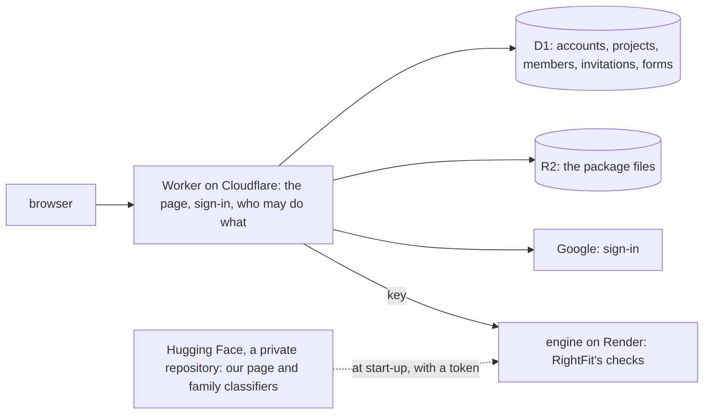

# Feature spec: RightFit online, the project space

20 Nov 2026. Features MAF-31 to MAF-33 in `spec/constitution/roadmap.md`. Built like the app of the AI Methods hackathon (16 to 20 Nov): a page and a Worker on Cloudflare, accounts with Better Auth, D1 for facts, R2 for files, and the Python part on Render.

## 1. What it does

RightFit online is where the parties of one project meet around the material approval forms. A consultant opens the project and invites the contractor and the other reviewers. The contractor invites its subcontractors. Everyone signs in with Google or with an email and a password, and sees only what their role in that project lets them see.

Then the forms move through it: a subcontractor prepares a package, the contractor runs RightFit's check before sending it on, the reviewers answer, and everyone sees whose turn it is and since when. The register says why this matters: after the last reviewer had answered, a form still waited a median of 7 days before it got back to the contractor (`mission.md` §1). That time is spent carrying paper, not reading it.

The review app on the laptop (`app/review_server.py`) stays the reviewer's working tool. RightFit online is the shared space around it.

## 2. How it fits the constitution

- Humans decide. The app never answers a form: it shows RightFit's draft, labelled as RightFit's, next to the reviewer's own answer.
- The project's real packages may be stored in the app's private storage (R2), because the project's parties agreed to their use (Luca, 20 Nov 2026). They never go into Git, which is public.
- Every request is checked on the server, in this order: signed in, terms accepted, a member of the project, and the role allows it. Every query names the project and the person.
- Secrets (the session secret, Google's client secret, the key between the Worker and the engine) are Cloudflare or Render secrets, never in the code.
- The checks stay the deterministic Python in `checks/`; the engine on Render runs the same code as the tests.
- The new dependencies are listed in `docs/decisions.md`.

## 3. The parts

| Part | Where | What it keeps |
|---|---|---|
| The page (React) | Cloudflare, static files | nothing secret: anyone can read a page's code |
| The Worker | Cloudflare | the API, sign-in and the rules of who may do what (`web/worker/`) |
| D1 | Cloudflare | accounts, projects, members, invitations, and later the forms and their steps |
| R2 | Cloudflare | the files of the packages (MAF-32) |
| The engine | Render | nothing: it runs the checks on a package and answers (MAF-33) |
| Our models | Hugging Face, private | the page classifier and the family classifier, each with its model card; private because they learned from the real packages and their words can carry names from the forms |

## 4. Roles, and who invites whom

A role belongs to a person in one project: the same person can be a contractor in one project and a subcontractor in another.

| Role | In Romanian | Comes in through | May invite |
|---|---|---|---|
| consultant | consultant | creates the project, or another consultant | consultant, designer, site supervisor, client, contractor |
| designer | proiectant | a consultant | designer |
| site supervisor | diriginte de șantier | a consultant | site supervisor |
| client | beneficiar | a consultant | client |
| contractor | antreprenor | a consultant | contractor, subcontractor |
| subcontractor | subcontractor | the contractor | subcontractor |

Everyone may invite a colleague in their own role. The team page draws the chain from who invited whom.

## 5. What each role sees

| Role | People | Forms (MAF-32) |
|---|---|---|
| consultant, designer, site supervisor, client | the whole team | every form sent to the reviewers |
| contractor | the whole team | every form of the project |
| subcontractor | the reviewers, the contractor, the people above it in the chain and its own branch | the forms of its branch |

A branch starts at the first person of a firm in the chain. It holds that person, the colleagues they brought in with the same role, and everyone any of them invited, down the chain. A subcontractor never sees another subcontractor's branch. Pending invitations follow the same rule: reviewers and the contractor see all of them, the others only those sent from their own branch.

## 6. Signing in and invitations

- Sign in with Google, or with an email and a password of at least 10 characters, kept only as a salted slow hash. The terms and the privacy note are accepted once for each version.
- An invitation holds the project, the email, the role, the company, who invited, when, an expiry of 14 days and a secret token. The page shows the link `/join/<token>` to the person who invites, to send in their own email: the app sends no email (§9).
- To accept, a person needs the link and an account with the same email. A pending invitation also appears on the home screen of a Google account with that email, because Google has verified the address.
- The token is kept only as a hash, so the database alone can't be used to join.
- Whoever sent an invitation, or any consultant, may withdraw it while it is pending. A consultant may remove a member; the project keeps at least one consultant.
- "Delete my account" removes the person's sessions, sign-in links, consent and memberships. A project where they are the only consultant asks them to hand it over first.

## 7. Data

Better Auth's tables (`user`, `session`, `account`, `verification`) and:

| Table | Columns |
|---|---|
| `consent` | person, terms version, date |
| `project` | id, name, country (RO or ES), who created it, when |
| `member` | project, person, role, company, who invited them (member id), when they joined |
| `invitation` | id, project, email, role, company, who invited (member id), the token's hash, when, expiry, state (pending, accepted, declined, withdrawn) |

MAF-32 adds the forms, their files and their steps.

## 8. The interface

- One sign-in screen: Continue with Google first, the email below. A person who came with an invitation sees it on the same screen: who invited them, to which project, as what.
- Home: what waits for this person first (invitations; later, forms to answer or to fix), then their projects, each with their role in it.
- The project: the team as the chain, top to bottom, reviewers, contractor, subcontractors; each person with name, company, role and who invited them; pending invitations drawn dashed. Invite offers only the roles this person may invite.
- English, as everything in the repository. The colours and type of the review app, so both read as RightFit. It works on a phone, at 375 px wide.

## 9. Phases

| ID | What | Done when |
|---|---|---|
| MAF-31 | Accounts, projects, roles and invitations, with Google | it runs locally and online, and the rules of who may invite whom and who sees what have tests |
| MAF-32 | Forms: a subcontractor prepares a form and its files, the contractor checks and sends it, each reviewer answers; everyone sees whose turn it is and since when | a form goes from a subcontractor to the reviewers and back, online |
| MAF-33 | The engine on Render: the Worker sends a package to RightFit's checks and shows the draft, labelled | the draft online matches the review app's on P01 and P02 |
| MAF-34 | The BOQ register, after MAF-31 to MAF-33 (Luca, 20 Nov): for each category of the BOQ, which lines an approved form already covers. One form covers a range: a data sheet for 30 diameters of one pipe covers all 30 lines, so they need no form each | its own spec, written when MAF-33 is done |

## 10. Tests

The rules of who may invite whom and who sees what are one small module, `web/worker/roles.ts`, with tests that run with Node's own test runner (`npm test`). The routes are tried locally with five accounts, the way people would use them: a person who is not a member gets "not found" for the project, a subcontractor can't invite a contractor nor see another subcontractor, an invitation can't be accepted from an account with another email nor twice, only a consultant takes people out, and deleting an account withdraws its pending invitations.

## 11. Open questions [O]

- Suppliers in the chain, invited by a subcontractor to add the makers' documents. Left out on 20 Nov 2026: letting the makers' resellers into a project could bring conflicts of interest (Luca). Kept as an idea for later.
- Sending invitations by email, through a mail service (the link is copied by hand in MAF-31).
- Whether a form's answer is the consultant's alone or each reviewer's; the register has four reviewer columns.
- Who pays once the free plans of Cloudflare and Render are not enough.
